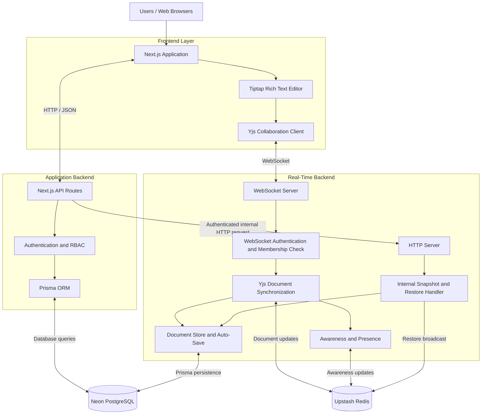

# Nexvia FS-02 - System Architecture

## 1. Project Overview

Nexvia FS-02 is a real-time collaborative workspace application that allows multiple users to work together on shared pages.

The system consists of a Next.js application, a separate Node.js WebSocket server, PostgreSQL persistence, and Redis-based cross-instance communication.

The architecture separates standard application operations from real-time collaborative document synchronization.

## 2. Technology Stack

| Layer | Technology | Responsibility |
|---|---|---|
| Frontend | Next.js, React, Tailwind CSS | User interface and workspace experience |
| Rich Text Editor | Tiptap | Rich-text document editing |
| Collaboration | Yjs, y-protocols | Real-time document synchronization and awareness |
| Application Backend | Next.js App Router API | Authentication, workspaces, pages, comments and versions |
| Real-Time Backend | Node.js, WebSocket (`ws`) | Collaborative connections and synchronization |
| ORM | Prisma | Database access and data modeling |
| Database | PostgreSQL (Neon) | Persistent application data and Yjs document state |
| Cross-Instance Communication | Redis (Upstash) | Document updates and awareness propagation |

## 3. High-Level Architecture

## 4. Main Components

### 4.1 Frontend

The frontend provides:

- User registration and login
- Workspace dashboard
- Workspace and member management
- Page creation and editing
- Rich-text editing using Tiptap
- Collaborative editing using Yjs
- Online collaborator presence
- Comments and comment resolution
- Version history and restore interface

### 4.2 Application API

Next.js API route handlers manage:

- Authentication and session validation
- Workspace creation and retrieval
- Member management and role assignment
- Page creation, retrieval, updating and deletion
- Comment creation, updating, resolution and deletion
- Version creation, listing and restoration
- Database health checks

Prisma provides access to PostgreSQL for application data.

### 4.3 Real-Time Server

The separate Node.js server uses HTTP and WebSocket functionality.

Its responsibilities include:

- Accepting WebSocket connections
- Authenticating users through the existing HTTP-only login cookie
- Checking page existence and workspace membership
- Enforcing edit permissions for incoming document updates
- Managing Yjs collaborative document synchronization
- Managing awareness and online presence
- Loading and saving document state
- Handling internal snapshot and restore requests

### 4.4 Document Store and PostgreSQL

The document store maintains loaded Yjs documents in memory.

Its responsibilities include:

- Loading saved document state from PostgreSQL
- Creating Yjs document instances
- Applying collaborative updates
- Scheduling document persistence
- Replacing documents during restoration
- Flushing loaded documents during server shutdown

Document changes are saved using Prisma and the `PageDocument` model.

The document store uses a 500 ms delayed save mechanism to reduce frequent database writes.

PostgreSQL stores:

- User accounts
- Workspaces and memberships
- Pages
- Yjs document state
- Comments
- Saved page versions

### 4.5 Redis Pub/Sub

Redis supports communication between separate real-time server instances.

The implementation uses:

- A Redis publisher
- A Redis subscriber
- Page-specific Pub/Sub channels
- Document update messages
- Awareness update messages
- Document restore messages

Each instance ignores its own published messages to prevent processing its own updates again.

### 4.6 Version Snapshot Service

The internal snapshot service is handled by the real-time server's HTTP server.

It supports:

- Creating document snapshots
- Validating snapshot data
- Restoring previous document snapshots
- Authenticating internal requests using `REALTIME_INTERNAL_SECRET`

Snapshots are stored in PostgreSQL through the `PageVersion` model.

## 5. Important Data Flows

### 5.1 User Authentication

1. User submits login or registration details.
2. Next.js API validates the request.
3. User information is read or stored using Prisma.
4. The authentication session is established using the application cookie.
5. Protected API operations verify the authenticated user.

### 5.2 WebSocket Connection

1. A user opens a workspace page.
2. The frontend establishes a WebSocket connection.
3. The real-time server validates the authentication cookie.
4. The server checks whether the requested page exists.
5. Workspace membership is verified.
6. The Yjs document is loaded from the document store.
7. The WebSocket connection is accepted for the authorized user.

### 5.3 Collaborative Editing

1. The frontend initializes the Tiptap editor and Yjs collaboration client.
2. The client connects to the real-time WebSocket server.
3. Yjs synchronizes document updates between connected collaborators.
4. Local document changes are published to Redis.
5. Other real-time server instances receive remote updates.
6. Document state is persisted to PostgreSQL through the document store.

### 5.4 Online Presence

1. Connected users publish awareness information.
2. The real-time server processes awareness updates.
3. Awareness updates are published to Redis.
4. Other real-time server instances receive and apply those updates.
5. Connected collaborators can see online presence and cursor information.

### 5.5 Comments

1. An authenticated user submits a comment.
2. The API checks page access and comment permissions.
3. The comment is stored in PostgreSQL.
4. Authorized users can view and manage comments.

### 5.6 Version History and Restore

1. An authorized user requests a version snapshot.
2. The Next.js API sends an authenticated internal HTTP request to the real-time server.
3. The real-time server loads and persists the current Yjs document.
4. The document snapshot is encoded and returned to the API.
5. The API saves the snapshot as a `PageVersion` record in PostgreSQL.
6. When restoration is requested, the API sends the selected snapshot to the internal restore endpoint.
7. The real-time server replaces the local document and persists the restored state.
8. Existing connections are closed so clients reconnect to the restored document.
9. The restore update is published through Redis to other real-time server instances.

## 6. Security and Access Control

The application uses:

- Cookie-based authentication
- Password hashing
- Workspace membership checks
- Role-based authorization
- Request validation
- WebSocket connection authentication
- Edit permission checks for collaborative document updates
- Protected internal snapshot communication using a server-side secret
- Server-side database operations

Supported workspace roles:

- OWNER
- ADMIN
- EDITOR
- COMMENTER
- VIEWER

## 7. Deployment Architecture

The application uses managed infrastructure:

- Next.js application: frontend and application API
- Separate Node.js service: real-time WebSocket server
- Neon: managed PostgreSQL database
- Upstash: managed Redis service

Deployment URLs and production configuration will be documented after deployment is completed.

## 8. Conclusion

The architecture separates application workflows from real-time collaboration.

Next.js handles application operations and access control, while the dedicated WebSocket server manages collaborative document synchronization and online presence.

PostgreSQL provides persistent application and document storage, while Redis enables communication between real-time server instances.

This modular architecture provides a foundation for collaborative editing, document persistence, version restoration and multi-instance communication.

---

**Project:** Nexvia FS-02 - Real-Time Collaborative Workspace
**Architecture:** Next.js + WebSocket + Yjs + PostgreSQL + Redis
