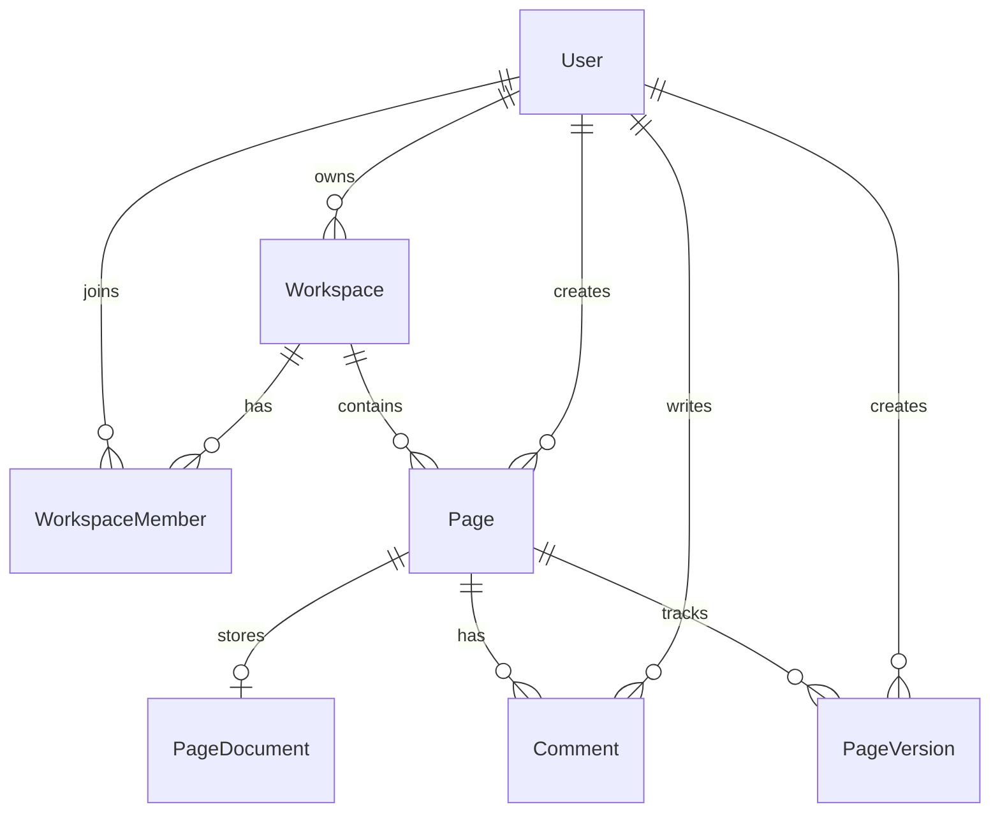

# Nexvia FS-02 — Database Documentation

## 1. Overview

Nexvia FS-02 uses PostgreSQL as its primary relational database.

The database is managed through Prisma ORM and hosted on Neon PostgreSQL.

The schema contains seven models and one enum:

1. User
2. Workspace
3. WorkspaceMember
4. Page
5. PageDocument
6. Comment
7. PageVersion

Enum:
- WorkspaceRole

## 2. Entity Relationship Diagram

## 3. Database Models

### 3.1 User

Stores registered user account information.

| Field | Type | Description |
|---|---|---|
| id | String | Primary key, generated using cuid |
| name | String | User's name |
| email | String | Unique email address |
| passwordHash | String | Hashed password |
| avatarUrl | String? | Optional avatar URL |
| createdAt | DateTime | Account creation time |
| updatedAt | DateTime | Last update time |

Relations:
- Can own multiple workspaces.
- Can have multiple workspace memberships.
- Can create multiple pages.
- Can write multiple comments.
- Can create multiple page versions.

### 3.2 Workspace

Stores collaborative workspace information.

| Field | Type | Description |
|---|---|---|
| id | String | Primary key |
| name | String | Workspace name |
| description | String? | Optional description |
| ownerId | String | Workspace owner's user ID |
| createdAt | DateTime | Creation time |
| updatedAt | DateTime | Last update time |

Relations:
- Belongs to one owner.
- Contains multiple members.
- Contains multiple pages.

### 3.3 WorkspaceMember

Connects users with workspaces and stores their roles.

| Field | Type | Description |
|---|---|---|
| id | String | Primary key |
| workspaceId | String | Related workspace ID |
| userId | String | Related user ID |
| role | WorkspaceRole | Member's workspace role |
| createdAt | DateTime | Membership creation time |

Constraints:
- Unique combination of workspaceId and userId.
- Index on userId.

### 3.4 Page

Stores workspace page metadata and optional JSON content.

| Field | Type | Description |
|---|---|---|
| id | String | Primary key |
| title | String | Page title, default: Untitled Page |
| workspaceId | String | Parent workspace ID |
| createdById | String | Page creator's user ID |
| content | Json? | Optional JSON content |
| createdAt | DateTime | Creation time |
| updatedAt | DateTime | Last update time |

Relations:
- Belongs to one workspace.
- Belongs to one creator.
- Has an optional PageDocument.
- Can have multiple comments.
- Can have multiple versions.

Constraint:
- Index on workspaceId.

### 3.5 PageDocument

Stores the binary collaborative document state.

| Field | Type | Description |
|---|---|---|
| pageId | String | Primary key and related page ID |
| state | Bytes? | Optional binary document state |
| updatedAt | DateTime | Last update time |

Relationship:
- One page can have an optional PageDocument.
- The PageDocument belongs to one Page.

### 3.6 Comment

Stores page comments and their resolution status.

| Field | Type | Description |
|---|---|---|
| id | String | Primary key |
| pageId | String | Related page ID |
| authorId | String | Comment author's user ID |
| content | String | Comment text |
| anchor | Json? | Optional comment anchor metadata |
| resolved | Boolean | Resolution status, default false |
| createdAt | DateTime | Creation time |
| updatedAt | DateTime | Last update time |

Constraints:
- Index on pageId.

### 3.7 PageVersion

Stores saved document snapshots for version history.

| Field | Type | Description |
|---|---|---|
| id | String | Primary key |
| pageId | String | Related page ID |
| createdById | String | User who created the version |
| snapshot | Bytes | Binary document snapshot |
| createdAt | DateTime | Version creation time |

Constraints:
- Composite index on pageId and createdAt.

## 4. WorkspaceRole Enum

The application defines five workspace roles:

| Role | Description |
|---|---|
| OWNER | Workspace owner |
| ADMIN | Workspace administrator |
| EDITOR | Can edit permitted workspace content |
| COMMENTER | Can participate through comments |
| VIEWER | Read-only workspace access |

Actual permissions are enforced by the application's authorization logic.

## 5. Relationships and Data Integrity

- A user can own multiple workspaces.
- Workspace membership connects users and workspaces.
- A workspace can contain multiple pages.
- Each page belongs to a workspace and has a creator.
- A page can have one associated PageDocument.
- A page can contain multiple comments.
- A page can have multiple saved versions.
- Comments and versions reference their respective authors.

Foreign key relationships are defined in the Prisma schema.

Cascade deletion is configured for:
- WorkspaceMember when its workspace or user is deleted.
- Page when its workspace is deleted.
- PageDocument, Comment and PageVersion when their parent page is deleted.

## 6. Indexes and Constraints

| Model | Constraint / Index |
|---|---|
| User | Unique email |
| WorkspaceMember | Unique workspaceId + userId |
| WorkspaceMember | Index on userId |
| Page | Index on workspaceId |
| Comment | Index on pageId |
| PageVersion | Composite index on pageId + createdAt |

## 7. Database Technology

- Database: PostgreSQL
- Hosting: Neon
- ORM: Prisma
- Database client: Prisma Client with PostgreSQL adapter

The Prisma schema is maintained in:

`prisma/schema.prisma`

## 8. Schema Validation

The Prisma schema was validated against the configured database.

Validation result:

`Database schema is up to date!`

The generated Prisma Client is used by the application for database operations.

---

**Project:** Nexvia FS-02 — Real-Time Collaborative Workspace
**Database:** PostgreSQL
**ORM:** Prisma
